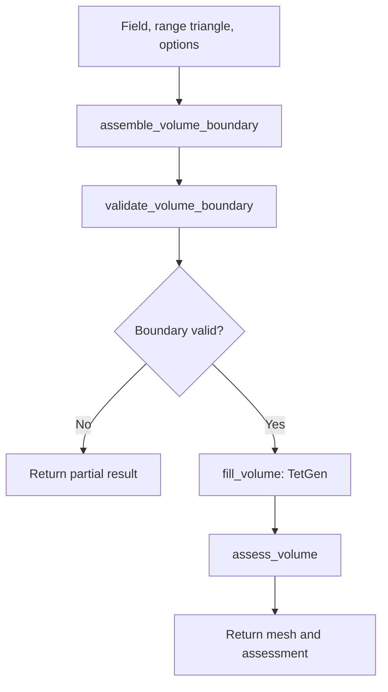

# Fiber-volume implementation walkthrough

The volume extractor first builds a closed triangle mesh around the selected
spatial region, then fills that mesh with tetrahedra. The main entry point is
`extract_volume()` in [volume_io.cpp](volume_io.cpp). The side surfaces come from the shared polyline extractor in
[curve_surface.cpp](curve_surface.cpp). Box-face caps are assembled in
[volume_boundary.cpp](volume_boundary.cpp).

This guide explains the current implementation and its function calls.
[VOLUME.md](VOLUME.md) contains build instructions, command examples, and
previously measured results. The mathematical specification is in the
“Extension to filled range triangles: volume extraction” section of
[summary_fiber.tex](../../fiber-surface-tex/summary_fiber.tex).

**What “volume” means here.** The input is a field with two scalar components
over a three-dimensional box:

```text
F(x, y, z) = (f1(x, y, z), f2(x, y, z))
```

You select a filled triangle in the two-dimensional field range. The desired
spatial region consists of every point in the box whose field value lies in
that triangle. The output includes both a tetrahedral representation of this
region and its numerical volume. A single range triangle can select several
disconnected spatial components or a region with cavities.

For counterclockwise range corners `q0`, `q1`, `q2`, the code constructs three
`Segment` objects, with indices taken modulo three:

```text
d_i       = q_(i+1) - q_i
n_i       = (-d_i.y, d_i.x) / |d_i|       inward range-space unit normal
phi_i(x)  = n_i · (F(x) - q_i)
g_i(x)    = J(x)^T n_i                    spatial gradient of phi_i

selected(x) = x is inside the box AND phi_0(x), phi_1(x), phi_2(x) >= 0
```

Here `J` is the 2-by-3 Jacobian of `F`. `Segment::phi()` actually takes an
already evaluated range value, so the corresponding C++ expression is
`range.sides[i].phi(field.value(x))`.

`RangeTriangle` rejects nonfinite, repeated, clockwise, and collinear or nearly
collinear corners; it does not reorder them. Its `contains(value, tolerance)`
method checks all three inequalities against `-tolerance`. The default
tolerance is zero.

**The planar prism makes the construction concrete.** For
`F(x,y,z) = (x,y)`, range corners `(0,0), (1,0), (0,1)`, and box
`[-1,2] × [-1,2] × [0,1]`, the three residuals are:

```text
phi_0 = y
phi_1 = (1 - x - y) / sqrt(2)
phi_2 = x
```

The selected region is therefore `x >= 0`, `y >= 0`, `x+y <= 1`, and
`0 <= z <= 1`: a triangular prism of volume `0.5`. Its three side surfaces
come from the range edges. Its top and bottom come from the spatial box.
The corner fibers are the three vertical lines through `(0,0)`, `(1,0)`,
and `(0,1)` in the xy-plane.

**The files separate field evaluation, geometry, validation, and output.**
These are the main places to read:

| File | Responsibility |
| --- | --- |
| [volume.h](volume.h) | Public functions and data structures shared by the volume stages. |
| [fiber_volume_explicit.cpp](fiber_volume_explicit.cpp) | Select an analytical example, parse options, and call `run_volume()`. |
| [fiber_volume_mfa.cpp](fiber_volume_mfa.cpp) | Load MFA models and variables, construct a `Field`, and call the same runner. |
| [fiber_volume_coordnet.cpp](fiber_volume_coordnet.cpp) | Load two scalar TorchScript models with the shared CoordNet field adapter and call the volume runner. |
| [volume_cli.h](volume_cli.h) | Parse the three range corners and reuse the common meshing options. |
| [curve_surface.cpp](curve_surface.cpp) | Extract the directed range loop and assemble shared corner fibers. |
| [volume_boundary.cpp](volume_boundary.cpp) | Orient the loop’s side surfaces outward and triangulate the box caps. |
| [volume_validation.cpp](volume_validation.cpp) | Check the boundary against geometry and the field; identify shells and cavity seeds. |
| [volume_tetgen.cpp](volume_tetgen.cpp) | Call TetGen and independently assess the returned tetrahedra. |
| [volume_io.cpp](volume_io.cpp) | Orchestrate the four stages and write meshes and the JSON report. |
| [volume_ply.cpp](volume_ply.cpp) | Write and read the labeled binary64 PLY shared by the boundary and fill invocations. |
| [volume_examples.h](volume_examples.h) | Analytical fields, range triangles, and reference volumes. |

The volume implementation reuses `fiber_surface_core`, including
[find_seeds.cpp](find_seeds.cpp),
[trace_endpoint_fibers.cpp](trace_endpoint_fibers.cpp),
[march_surface.cpp](march_surface.cpp), and
[stitch_surface.cpp](stitch_surface.cpp). Their `Extractor` class builds one
finite-segment fiber surface at a time. The surface core joins the patches along their corner fibers. The volume
layer closes their contact with the box.

The [CMake configuration](CMakeLists.txt) compiles the volume implementation files
into `fiber_volume_core`, links it to `fiber_surface_core` and TetGen, and
provides earcut headers for cap triangulation. All three volume executables link
this same library. `FIBER_ENABLE_VOLUME` controls these targets, and the
directory is active in [src/CMakeLists.txt](../CMakeLists.txt).

**The data structures describe successive stages of the same region.**
All public volume types are declared in [volume.h](volume.h).

| Type | Contents and meaning |
| --- | --- |
| `Field` | Callbacks for values, Jacobians, and two Hessians, plus the physical box; declared in [field.h](field.h). |
| `RangeTriangle` | Three range corners and their three directed `Segment` sides. |
| `VolumeBoundary` | Triangle `mesh`, one semantic `patches` label per triangle, unresolved events, corner-fiber component counts, and a box-contact repair count. |
| `BoundaryAssessment` | Topology results, a shell ID per triangle, signed shell volumes, cavity seed points in `holes`, model-error statistics, and `valid`. |
| `VolumeMesh` | TetGen vertices, four-index `cells`, marked output `boundary_faces`, and their `parent_facets`. |
| `VolumeAssessment` | Cell and face validity counts, conformity and overlap failures, output-boundary topology, volume totals, and sampled field errors. |
| `VolumeResult` | Both meshes, both assessments, `failed_stage`, and four stage durations. |

`Mesh` is an alias for the shared triangle-mesh implementation. Besides vertex
and triangle arrays, it maintains edge adjacency and exposed directed edges.
`Mesh::add()` updates these caches. Boundary validation reconstructs them from
the arrays so imported geometry need not carry the marcher's caches.

**`extract_volume()` is the core orchestration function.** Its inputs are a
field, a range triangle, and meshing options; its output is a `VolumeResult`.
It performs no file writing. The following diagram shows the successful path
and the gate that prevents filling an invalid boundary:



The control flow below is simplified from [volume_io.cpp](volume_io.cpp);
timing and detailed diagnostic text are omitted:

```cpp
for (const auto& side : range.sides)
    options.validate(field, side);

VolumeResult result;
result.boundary = assemble_volume_boundary(field, range, options);
result.boundary_report = validate_volume_boundary(
    result.boundary, field, range, options);

if (!result.boundary_report.valid) {
    result.failed_stage = "boundary_validation";
    return result;
}

try {
    result.mesh = fill_volume(result.boundary, result.boundary_report);
} catch (const std::exception& error) {
    result.failed_stage = "volume_filling";
    // The implementation also records error.what() as an unresolved event.
    return result;
}

result.report = assess_volume(result.mesh, result.boundary,
    result.boundary_report, field, range, options);
if (!result.report.valid)
    result.failed_stage = "volume_assessment";
return result;
```

`VolumeResult::complete()` requires an empty `failed_stage` and both assessments
to be valid. `seconds[0..3]` stores assembly, boundary validation, filling, and
volume assessment times in that order. A stage skipped by an early return
keeps its initial zero time.

`run_volume()` calls `extract_volume()`, writes the result with `write_volume()`,
prints a short status, and returns `0` when the requested stage passes or `2`
for a partial/invalid result. With `--stage boundary`, extraction stops after
boundary validation and the writer saves the labeled PLY. With `--stage fill`,
`read_boundary_ply()` supplies the triangles, winding and patch IDs. Boundary
validation then rebuilds adjacency and cavity seeds before calling TetGen.
The repository example script runs these two modes in separate processes.
Exceptions outside the filling catch, such as invalid options or output errors,
reach the executable's `main()` catch and produce exit `1`.

**Boundary assembly starts by tracing the shared corner fibers.**
`assemble_volume_boundary()` first copies the options and sets
`surface_solve_tolerance = min(1e-10, residual_tolerance)` to keep roots on
adjacent side patches accurate.

`assemble_volume_boundary()` passes the closed curve `[q0,q1,q2,q0]` to
`extract_curve()`. The surface core discovers surface seeds for every directed
side and endpoint seeds for each distinct range vertex. It traces the
components of each corner fiber once. Corner seeds, traced samples, and box
contacts use an absolute field tolerance of `1e-9`. For an interior sample,
the maximum distance to the correction plane is `1e-6 * step`.

The inherited tracer follows the normalized tangent
`grad(f1) × grad(f2)` using RK4 prediction and Newton correction. It follows
both directions when needed, detects closed loops, and solves contacts with
the box while fixing the contacted coordinates. Rank loss or a failed contact
is recorded as an unresolved event.

Each side takes the frozen traces at its two endpoints into a local `Result`.
The two incident patches keep the same component order and sample order along
a corner. After stitching, `join_curve_patches()` assigns the same global IDs
to those samples and records the range-segment index on every triangle.

**Each segment uses the existing surface marcher.** The patch loop in
`extract_curve()` runs the following steps.

```cpp
Extractor extractor(field,curve.segments[i],options);
auto state=extractor.march(seeds[i],std::move(patches[i]));
patches[i]=extractor.finish(std::move(state),true).result;
```

`march()` initializes fronts from the supplied fiber edges, grows triangles,
and tries independent surface seeds to discover components away from range
corners. `finish()` stitches the fronts, attempts local repairs and box
contacts, and records unfinished fronts and unattached fiber edges.

Within `Extractor::advance()`, a candidate grows across a front edge in the
direction `edge × g_i`. The Hessian combination
`n_i[0] * H_f1 + n_i[1] * H_f2` supplies a directional curvature estimate that
can reduce the prediction distance. `Corrector::surface()` projects the
candidate onto `phi_i = 0`, with selected box coordinates held fixed at
contacts. With no fixed coordinates, its Newton update has the form:

```text
x_new = x - phi_i(x) * g_i(x) / |g_i(x)|²
```

To keep a candidate triangle, the side marcher requires the closed segment
interval at its centroid and each untraced vertex, including vertices on
the box boundary. At a traced corner-fiber vertex it requires the field
value to be within `1e-9` of the assigned range corner. The raw segment
parameter at edge midpoints is diagnostic. The marcher also checks angles,
normals, topology, and conflicts with existing triangles. Volume validation
later checks the vertices, edge midpoints, and centroid against the active
volume constraints.

The side marcher orients triangles toward `+g_i`. The volume retains
`phi_i >= 0`, so its outward direction is `-g_i`. Assembly explicitly reverses
each side triangle from `{a,b,c}` to `{a,c,b}` when adding it to the boundary.

After marching, `finish_box_contacts()` handles a narrow leftover case: a
short front joins contacts on two different box faces but has not reached
their common box edge. It solves `phi_i = 0` with both box coordinates fixed
and applies the same range tests at the vertices and centroid before adding
the triangle. It also checks size, angles, orientation, topology, and
intersections. It leaves traced corner fibers fixed.
This repair is counted in `box_contact_triangles`.

If two unfinished edges meet at an untraced vertex and their other ends
lie on one box face, `snap_box_slivers()` tests the vertex against the
segment between those ends. Its projection must fall inside the segment.
Both the distance to the segment and the displacement of the face-constrained
surface correction must be at most `0.01 * step`. The corrected edges and
incident triangles must pass validation before the two edges join the cap
outline. This operation reuses the existing vertex and triangles. The
marcher's duplicate-vertex and intersection checks use `1e-9 * step`.

**`cap()` closes the selected portions of each box face.** Three side patches
alone need not enclose a volume: in the prism example, the top and bottom
would remain open. Assembly calls `cap()` once for each of the six box faces.

For a given face, it performs this sequence:

1. Collect exposed boundary edges whose endpoints lie on that face. Reverse
   their direction so cap triangles will meet side triangles with opposite
   edge winding.
2. Walk the four edges of the rectangular box face, split them at existing
   vertices, and add intervals whose midpoint satisfies all three range
   inequalities. This also supports an entirely selected box face.
3. Independently search the face for contacts with each range side, using
   constrained surface correction from a face grid. A discovered contact more
   than `2 * spatial_tolerance` from the graph produces an unresolved event.
4. Require one incoming and one outgoing edge at each graph vertex and trace
   closed loops. Branches, open loops, and degenerate regions are rejected.
5. Project the loops to 2D with a coordinate orientation consistent with the
   outward box normal. Positive signed-area loops represent selected outer
   regions; negative loops represent holes. Assign each hole to its smallest
   enclosing positive loop.
6. Pass each outer loop and its holes to `mapbox::earcut<uint32_t>()`, then
   convert the returned indices back to the shared 3D vertex IDs.
7. Restore any constrained collinear samples omitted during simplification or
   triangulation by splitting containing triangle edges. This preserves
   matching subdivisions at side/cap and cap/cap seams.
8. Orient the triangles outward from the box and attach their patch labels.

The projection subtracts a local origin before area calculations and earcut,
reducing cancellation when coordinates are far from zero. `compact()` then
removes unused vertices and rebuilds connectivity without changing facet order.

**Patch labels and parent facet IDs serve different purposes.**
`VolumeBoundary::patches[i]` tells you which constraint produced triangle `i`:

| Patch label | Boundary condition |
| --- | --- |
| `1` | Range edge `q0 → q1`, or `phi_0 = 0`. |
| `2` | Range edge `q1 → q2`, or `phi_1 = 0`. |
| `3` | Range edge `q2 → q0`, or `phi_2 = 0`. |
| `4`, `5` | `xmin`, `xmax`. |
| `6`, `7` | `ymin`, `ymax`. |
| `8`, `9` | `zmin`, `zmax`. |

A parent facet ID instead identifies one particular input triangle. TetGen
receives marker `i+1` for input triangle `i`; output markers are converted back
to zero-based `parent_facets`. Many facets can share one semantic patch label.

In VTK output, `incident_patch_mask` combines all labels touching a vertex
using bit `1u << (patch - 1)`. A vertex on a crease can therefore retain several
patch labels. This mask is distinct from `VertexInfo::faces`, whose six bits
refer only to box faces during surface extraction.

**Boundary validation checks that the assembled surface can define a volume.**
`validate_volume_boundary()` in [volume_validation.cpp](volume_validation.cpp)
returns a `BoundaryAssessment` and can add diagnostics to the boundary. Its
checks build on one another:

| Check | What the implementation examines |
| --- | --- |
| Closed mesh | Valid indices, finite/nondegenerate triangles, no duplicate faces or unused vertices, two oppositely oriented uses of every edge, manifold vertex neighborhoods, and triangle intersections. |
| Domain and labels | Every vertex is in the field box; every triangle has a patch in `1..9`. Out-of-domain vertices are rejected before field callbacks. |
| Sampled model agreement | Three vertices, three edge midpoints, and the centroid of every triangle: seven samples from `volume_triangle_samples()`. |
| Outward orientation | Side normals agree with `-J^T n_i`; cap normals agree with the outward box normal. |
| Active-constraint independence | At vertices, collect incident range gradients and box normals, normalize them, and check their matrix rank. |
| Shell containment | Find connected boundary shells, compute signed volumes, and check their signs against nesting depth. |
| Empirical coverage | Compare field membership with shell-based material membership on the discovery grid, away from the boundary. |

The underlying closed-mesh check is
[`marching_triangles::validate_mesh()`](../isosurface/mesh_validation.h).
Vertex-neighborhood checks matter because two surfaces touching only at a
vertex can pass an edge-incidence check but still fail to form a manifold.

The active-constraint test encodes the regular-volume assumption. A single
range side needs a nonzero residual gradient; two incident range sides need
independent gradients; box contacts must also be transverse to the other
incident constraints. A full-rank two-component field is not required
everywhere inside the volume. For example, a constant field strictly inside
the triangle can select the whole box, whose only boundary constraints are
the box faces.

**`correct_volume_sample()` measures sampled geometric agreement.** It takes
a mutable point and its assigned patch, then tries to find a nearby point
satisfying the boundary constraints. Validation passes a temporary copy, so
the stored triangle or tetrahedral mesh is not moved by this function.

It first preserves box faces already active at the sample and, for a cap,
fixes the assigned cap coordinate. For a range-side patch, that side's
`phi_i = 0` is active immediately. Any other range inequality violated by
more than `min(residual_tolerance, 1e-10)` is added to the active equalities.
Once added, it stays active during that correction attempt.

Each Newton iteration forms a matrix whose rows are the active gradients
restricted to the free spatial coordinates, then solves:

```text
A * delta_free = -active_residuals
```

Eigen's `CompleteOrthogonalDecomposition` supplies the correction. The method
fails if the rows lack rank, there are too many constraints for the free
coordinates, an iterate leaves the box, values become nonfinite, displacement
exceeds `spatial_tolerance`, or the iteration budget is exhausted.

This is a bounded local correction, not a computation of the globally closest
point. Successful correction shows that the sample has a nearby feasible
boundary point within the allowed displacement. A triangle with vertices on
a curved surface generally has midpoints and a centroid off that surface;
this is why the report records both raw field residuals and correction
distances. Raw residuals are measured before correction and need not be below
the stricter root-solve tolerance.

**Shells identify disconnected boundaries and enclosed cavities.** After the
local checks, validation traverses triangle adjacency to assign shell IDs.
For each oriented shell it computes:

```text
signed_volume = sum over its triangles (a,b,c):
    (a - origin) · ((b - origin) × (c - origin)) / 6
```

The local `origin` is a vertex of that shell. An outer boundary normally has
positive signed volume. A cavity boundary has negative signed volume because
its normal points out of retained material and into the cavity.

`inside_shell()` sums the signed solid angles of all triangles seen from a
query point. It classifies a point as inside when the absolute sum exceeds
`2*pi`. Containment in other shells determines nesting depth: even depths
require positive volume, odd depths negative volume. Material membership sums
`+1` for enclosing positive shells and `-1` for enclosing negative shells and
checks whether the result is positive.

For each negative shell, the code searches for a TetGen cavity seed. It casts
a ray from a facet centroid along its outward normal, takes the midpoint to
the nearest subsequent boundary hit, and checks that the candidate lies inside
that cavity shell, outside retained material according to all shells, outside
the field selection, and safely clear of the boundary. It keeps the candidate
with greatest tested clearance. Failure to find one remains unresolved.

A hole in a planar cap and a TetGen cavity seed are different objects. A
hollow cylinder has annular caps triangulated with 2D holes, while its bore
connects to the exterior. A hollow sphere has a separate enclosed inner shell
and needs a cavity seed. The regression examples exercise both cases.

The final coverage check compares `selected(x)` from the field with material
membership from the shells on the discovery grid. Disagreements farther than
`2 * spatial_tolerance` from the boundary increment `coverage_misses`.
Boundary validation succeeds only if its failure counts are zero and
`unresolved` is empty.

**`fill_volume()` hands a validated piecewise-linear boundary to TetGen.**
The function in [volume_tetgen.cpp](volume_tetgen.cpp) takes a boundary and its
assessment. Its signature has no `Field`: TetGen does not evaluate `F`, its
derivatives, or the range triangle.

It checks the boundary's validation status, copies its vertices and triangular
facets into `tetgenio`, attaches a unique parent marker to each facet, and
copies verified cavity seeds into `holelist`. It then calls:

```cpp
char switches[] = "pV";
tetrahedralize(switches, &in, &out);
```

`p` requests tetrahedralization of the piecewise-linear complex; `V` enables
verbose output. The caller supplies no interior point cloud or background
tetrahedral mesh, and requests no quality or maximum-cell-volume constraint.
TetGen may add Steiner vertices and subdivide input facets as needed.

The returned cells are required to have four corners. Their ordering is
adjusted toward positive signed volume. Marked output faces are associated
with their original facets and oriented consistently with them. TetGen integer
failure codes are converted to exceptions, which `extract_volume()` records
as a `volume_filling` failure.

**`assess_volume()` checks the returned mesh independently of TetGen's success
status.** It reconstructs face incidence directly from the tetrahedral cells
and performs the following checks:

1. Reject invalid vertex indices, nonfinite coordinates, repeated vertices,
   duplicate cells, and nonpositive or nearly zero cell volumes. The orientation
   wrapper uses TetGen's adaptive `orient3d` predicate with its sign reversed
   to match the exported cell convention.
2. For a face used by two cells, require the opposite vertices to lie strictly
   on opposite sides. Such a face must not also be marked as a boundary face.
   A face used by more than two cells is invalid.
3. For a face used by one cell, require a valid parent facet. Check that its
   vertices lie on that input triangle within tolerance and that the cell lies
   on the retained side of the outward-oriented parent.
4. Accumulate output boundary-face areas per parent and compare with every
   input facet's area. Reject missing, extra, duplicate, or inconsistent marker
   associations. This permits facet subdivision while checking coverage.
5. Build a compact output-boundary mesh and run the closed-mesh checks again.
   Recheck its seven samples per face against the field, including any new
   boundary vertices introduced by TetGen.
6. Check potential tetrahedron overlaps using bounding boxes followed by
   separating-axis tests with face-normal and edge-cross-edge axes. Correct
   face incidence alone would not exclude overlapping cells.
7. Compare the sum of positive cell volumes with the sum of signed shell
   volumes, which subtracts cavity volumes.

The volume sum is
`sum(det(b-a, c-a, d-a) / 6)`. Its agreement tolerance with the boundary sum
is `max(eps^3, 1e-8 * abs(boundary_volume))`, where `eps = step * 1e-8`.
This comparison assesses consistency with the extracted boundary; it does
not by itself measure error against the exact curved region.

The implementation compares orientation signs directly instead of multiplying
small determinants, uses stable axis norms and local coordinates for overlap
tests, and uses difference-based midpoint/centroid helpers in volume checks.
These choices address failures caused by small coordinate units or large
translations. They do not imply unrestricted numerical robustness at every
possible scale.

**The options control different sources of approximation.** These are the
most useful controls when reading or changing this code:

| Option | Role in this implementation |
| --- | --- |
| `step` | Fixed RK4 step along corner fibers and nominal growth step for side surfaces. Also scales geometric comparison tolerances. |
| `min_step` | Lower growth scale used by the surface marcher. |
| `spatial_tolerance` | Maximum distance from an endpoint seed to an existing trace of the same range point for skipping the seed. Also limits local correction displacements for sampled geometry. Both distances use physical coordinates. |
| `residual_tolerance` | Bounds surface projection residuals and enters volume constraint checks. Must be less than one percent of each range-side length. |
| `derivative_tolerance` | Threshold used in derivative and rank checks. |
| `seed_grid` | Starting-point count on the shortest box axis; other counts scale with physical axis length. Default `7`; `0` also selects `7`. |
| `iterations`, `max_trace_steps` | Limits for nonlinear corrections and fiber tracing. |
| `max_triangles` | Surface triangle budget per range side; not a limit on all caps or on tetrahedra. |

In the CLI, omitted `min_step` and `spatial_tolerance` are computed from
the shared `step` as `step/8` and `0.075*step`.
Direct C++ use of `Options` retains its member defaults unless you update
them yourself. The analytical `curved-prism` and `sphere` CLI examples set
`residual_tolerance` to `0.005` before parsing overrides; most examples start
with `1e-9`. The MFA CLI initially sets `step` to one twentieth of the model
intersection box's shortest side, before applying CLI options.

Reducing `step` refines both the shared curves and the side patches.
Increasing `seed_grid` supplies more discovery starts. None alone
guarantees successful closure or discovery of every component.

**Analytical and MFA inputs use the same geometry code.** Both provide the
`Field` callbacks in physical coordinates. The analytical examples supply
formula-based values and derivatives. [mfa_field.h](mfa_field.h) wraps two MFA
scalar evaluators, enables Hessians, intersects their physical block domains,
and provides thread-local evaluator copies for parallel seed discovery.

The MFA executable can select two variables from one model or scalar variables
from separate models, with explicit block selection. Loading and evaluation
happen before the shared volume pipeline; it performs no model fitting.
`--inspect` takes a separate path that samples the field range and exits.
Errors relative to the original data used to fit an MFA model are not measured
by the volume checks, which assess the supplied model.

**The outputs expose both geometry and the reason for failure.** For prefix
`P`, `write_volume()` creates these files, including when extraction returns
a partial result:

| Output | Useful contents |
| --- | --- |
| `P_boundary.ply` | Binary64 vertices, oriented faces and patch IDs for the fill stage. Written when the boundary is assembled. |
| `P_boundary.obj` | Assembled triangles grouped by semantic patch. |
| `P_boundary.vtk` | Boundary triangles with patch IDs, shell IDs, and incident patch masks. |
| `P_boundary.poly` | Boundary PLC, unique facet markers, and cavity seeds; validation status must be checked before independently filling it. |
| `P_volume.vtk` | Returned tetrahedral mesh, using VTK cell type `10`. |
| `P_tet_boundary.vtk` | TetGen's marked boundary faces, including subdivisions, with parent and patch labels. |
| `P_report.json` | Completion status, failures, error statistics, counts, volumes, seeds, and stage timings. |

For debugging, start with `complete`, `failed_stage`, and `unresolved`, then
use the corresponding counters:

| Report field | What to investigate |
| --- | --- |
| `topology` | Open edges, inconsistent winding, nonmanifold contacts, or intersecting input triangles. |
| `constraint_failures` | Domain, assigned patch, correction, or active-gradient failures. |
| `orientation_failures` | A missing or misaligned outward normal, or a shell signed volume inconsistent with its nesting depth. |
| `coverage_misses` | Sampled disagreement between the model selection and the assembled shells. |
| `max_side_residual`, `max_corner_residual` | Raw field errors relative to a side or shared range corner, including chord samples. |
| `max_inequality_violation`, `max_spatial_error` | Largest sampled raw violation and largest successful correction distance. |
| `invalid_cells`, `invalid_faces` | Cell geometry or reconstructed face-incidence failures. |
| `conformity_failures`, `tet_intersections` | Parent-facet, output-boundary, volume-consistency, or cell-overlap failures. |
| `tet_max_*` | Field and correction statistics sampled on the returned tetrahedral boundary. |

Residual and corner statistics are diagnostics, not separate guarantees of a
global error bound. Use the completion flag and failure counts together with
them. Reusing an output prefix overwrites old files; a boundary-validation
failure writes an empty tetrahedral mesh so an old successful volume does not
remain under that prefix.

**The tests exercise geometry, adapters, and rejection paths.**
[volume_tests.cpp](volume_tests.cpp) checks reference volumes for the planar
and curved prisms, whole-box selection, shells, annular caps, and disconnected
components. Its `validation` case deliberately removes a boundary triangle,
removes or duplicates a cell, and corrupts a parent facet marker.

[volume_review_tests.cpp](volume_review_tests.cpp) covers invalid patch IDs,
out-of-domain geometry, rebuilding absent adjacency caches, malformed cells,
preserving all active cap constraints, and a selected box translated near
`1e9`. Its small-scale cases assess an already extracted mesh rescaled by
`1e-8` and `1e-55`; they do not rerun the complete extraction at those scales.

[volume_mfa_tests.cpp](volume_mfa_tests.cpp) writes exact polynomial MFA
fixtures, checks values/Jacobians/Hessians against the analytical fields, and
then extracts both prism volumes.
[volume_cli_test.py](volume_cli_test.py) checks input rejection, output files,
and replacement of a successful output with an empty volume after a later
incomplete extraction. These describe the existing tests; this walkthrough
does not report a new execution of them.

**The current guarantees are numerical and sampled.** Discovery uses finitely
many starting points. Model agreement uses finitely many boundary samples and
grid membership probes; the code does not certify the selection everywhere
inside every tetrahedron. Small components can escape discovery, and a valid
tetrahedralization can still approximate a curved model boundary with error.

A side with no discovered surface seeds and no triangles has its specific
“No regular surface discovered” diagnostic suppressed, allowing inactive
range edges and whole-box selection. Other diagnostics remain, and independent
face and coverage checks still run. An entirely empty selection currently
fails boundary validation rather than returning a successful empty volume.
Dependent active constraints, unresolved fronts, ambiguous face graphs, and
unverified cavities also prevent completion. Several geometry checks compare
many pairs of primitives, so the implementation targets small to moderate
meshes.

To follow one extraction in a debugger, start at `extract_volume()`, step into
`assemble_volume_boundary()` and `extract_curve()`, inspect the
assembled `patches` and `unresolved`, then follow the two validation reports
around `fill_volume()`. The planar prism is the clearest case because each
range side, corner fiber, box cap, and expected volume has a simple geometric
interpretation.
